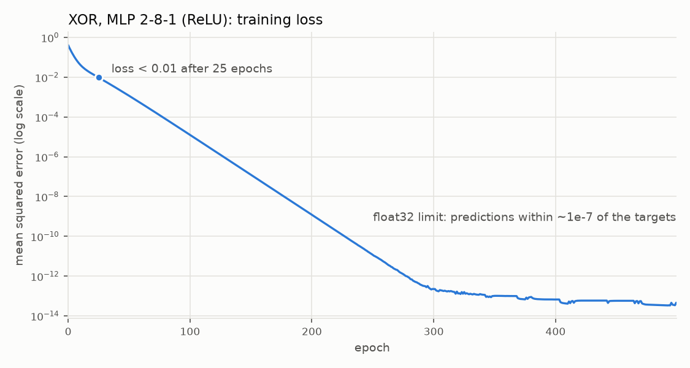

# mini-tensor

A small tensor library with reverse-mode automatic differentiation, written from scratch in C++17
to understand how PyTorch works under the hood: strides and views, broadcasting, the autograd graph
and the backward pass through it.

- **Tensors are views over shared storage.** `transpose`, `slice` (with a step), `reshape` and `expand`
  only change shape, strides and offset; `contiguous()` copies only when it has to.
- **NumPy-style broadcasting** for `+`, `-`, `*`, done with `expand` (stride 0, no copying).
- **Reverse-mode autograd.** Every operation records a `Node` with a virtual `backward`;
  `backward()` walks the graph in topological order and accumulates gradients in the leaves.
  Views are differentiable too.
- **Operations:** `add`, `sub`, `mul`, `relu`, `matmul` (2-D), `sum` (all elements, or along a dim with
  `keepdim`), `mean`.
- **Checked against PyTorch:** forward values and gradients of 13 cases agree within `1e-5`
  (10 of them bit for bit), besides hand-written unit tests and a numerical gradient check.
- **No leaks by design:** the graph owns only "backwards"; tests and a LeakSanitizer build check it.
- **XOR demo:** a 2-8-1 network trained with plain gradient descent.

Scope: float32 on the CPU, single-threaded. The code favours being easy to read over being fast.

## Example

```cpp
#include "minitensor/autograd.hpp"
#include "minitensor/ops.hpp"

#include <iostream>

int main() {
    mt::Tensor x = mt::from_data({1, 2, 3, 4, 5, 6}, {2, 3});
    mt::Tensor w = mt::randn({3, 1}, /*seed=*/1).set_requires_grad(true);
    mt::Tensor b = mt::zeros({1}).set_requires_grad(true);

    mt::Tensor y = mt::relu(mt::matmul(x, w) + b);  // [2, 1]; b is broadcast over the rows
    mt::Tensor loss = mt::mean(y * y);
    loss.backward();

    std::cout << w.grad().value() << '\n';  // d loss / d w, shape [3, 1]

    mt::Tensor t = x.transpose(0, 1);  // a view: same buffer, strides [1, 3] instead of [3, 1]
    std::cout << t.is_contiguous() << '\n';  // 0
}
```

## How it works

### Tensor, storage and views

```
Tensor (handle) ──shared_ptr──► TensorImpl                           Storage
`Tensor b = a;` is the          shape, strides, offset ────────────► std::vector<float>
same tensor, as in PyTorch      requires_grad, grad                  (one buffer, many views)
                                grad_fn ───► Node (how to compute the gradient)
```

Element `[i, j]` lives at `storage[offset + i * strides[0] + j * strides[1]]`. A row-major `[2, 3]`
tensor has strides `[3, 1]`; its transpose is `[3, 2]` with strides `[1, 3]`: the same buffer, no copy,
but reading it row by row now jumps around memory, so it is no longer contiguous. `slice` with a step
multiplies a stride and moves the offset. `expand` gives a dimension stride 0, so every index along it
reads the same element; that is how broadcasting works without copying. `reshape` returns a view when
the tensor is contiguous and a copy otherwise, like `torch.reshape`.

### Autograd

```
loss ──grad_fn──► MeanBackward ──inputs──► y ──grad_fn──► ReluBackward ──inputs──► ...
                                                                       (down to the leaves w, b)
```

- If an input requires grad, an operation attaches a node to its result. The node keeps its inputs
  alive and implements the vector-Jacobian product, e.g. for `C = A @ B`: `dA = dC @ Bᵀ`, `dB = Aᵀ @ dC`.
- `backward()` sorts the graph topologically (DFS from the loss) and runs the nodes from the loss
  towards the leaves. A result used by several operations gets the sum of their gradients; leaves
  accumulate into `grad()` with `+=`.
- Broadcasting is undone in backward by summing over the broadcast dimensions.
- Ownership points only backwards: result → node → inputs. A node never holds a `shared_ptr` to its own
  result, because that cycle would leak the whole graph on every training step. Tests check this with
  `weak_ptr::expired()`; the sanitizer build checks it with LeakSanitizer.
- `NoGradGuard` (RAII, like `torch.no_grad()`) turns recording off for optimizer steps and evaluation.
  `sub_`, the in-place update, refuses to change a tensor that requires grad while recording is on.

## Build and test

Requirements: a C++17 compiler (tested with GCC 13.3), CMake 3.24 or newer, Ninja (optional).
CMake downloads GoogleTest by itself.

```bash
cmake -S . -B build -G Ninja
cmake --build build
ctest --test-dir build --output-on-failure
```

With AddressSanitizer, LeakSanitizer and UndefinedBehaviorSanitizer (any error fails the test):

```bash
cmake -S . -B build-asan -G Ninja -DMT_SANITIZE=ON
cmake --build build-asan && ctest --test-dir build-asan --output-on-failure
```

### How it is tested

| Layer | What it checks |
|---|---|
| Unit tests (GoogleTest) | values computed by hand, shapes and strides of views, errors (exceptions) |
| Gradient check | every backward formula against central differences |
| PyTorch reference | forward values and gradients of 13 cases against PyTorch 2.15, `torch.allclose` rule with `atol = rtol = 1e-5` |
| XOR demo | end to end: the network has to learn XOR (registered in ctest) |

The reference data in `tests/data/` are committed together with the script that generates them
(fixed seed, PyTorch version in each file), so the C++ tests do not need Python. To regenerate them:

```bash
python3 -m venv .venv && .venv/bin/pip install -r scripts/requirements.txt
.venv/bin/python scripts/gen_reference.py
```

With zero tolerance, 10 of the 13 cases match PyTorch bit for bit. The others differ by one or two units
in the last place, only where numbers are summed (matrix products, undoing broadcasting), because the
two libraries add them up in a different order.

## XOR demo

```bash
./build/examples/xor_mlp build/loss.csv
.venv/bin/python scripts/plot_loss.py build/loss.csv docs/img/loss.png
```

A 2-8-1 network with ReLU, He initialization, mean squared error and full-batch gradient descent
(learning rate 0.1, 500 epochs). The training loop has the same shape as in PyTorch:

```cpp
for (int epoch = 0; epoch < kEpochs; ++epoch) {
    for (mt::Tensor& p : params) p.zero_grad();
    const mt::Tensor loss = mse(model.forward(x), y);
    loss.backward();
    sgd_step(params, lr);  // under NoGradGuard: p.sub_(lr * p.grad().value())
}
```



It learns XOR with every seed from 0 to 19. With only 2 hidden units, 15 of the 20 runs get stuck,
e.g. at a loss of 0.25: the hidden units have died (ReLU inactive for every input) or stopped depending
on the input, so the network answers 0.5 for everything.

## Project layout

```
include/minitensor/  tensor.hpp (Tensor, views, factories), ops.hpp (math), autograd.hpp (Node, NoGradGuard)
src/                 tensor.cpp, ops.cpp, autograd.cpp, internal.hpp (private helpers)
tests/               unit tests, gradcheck.hpp, reference.hpp/.cpp, data/ (PyTorch reference data)
examples/            xor_mlp.cpp
scripts/             gen_reference.py, plot_loss.py, requirements.txt
docs/img/            loss.png
```

## Limitations

- float32, CPU, one thread, no SIMD or BLAS: `matmul` is a plain triple loop.
- `matmul` takes 2-D tensors only.
- No version counters: changing a tensor through `at()` after the graph has used it silently gives wrong
  gradients (PyTorch detects this case).
- No module or optimizer classes; the demo writes the training loop by hand.

## What I learned

- A tensor is a flat buffer plus shape, strides and offset. That is why `transpose` is free but leaves
  the tensor non-contiguous, and why `reshape` can sometimes be a view and sometimes must copy.
- Broadcasting is `expand` with stride 0, and its backward is a sum over the broadcast dimensions.
- Reverse-mode autograd is a graph of vector-Jacobian products: a topological order, gradients that add
  up when a tensor is used twice, and formulas such as `dA = dC @ Bᵀ` derived by hand.
- Ownership in a graph of `shared_ptr`s: a node must not own its own result, and LeakSanitizer reports
  such a cycle only as "indirect" leaks.
- Testing numerical code: gradient checking with finite differences, an independent reference (PyTorch),
  and comparing floats with a tolerance, since the order of additions changes the last bits.
- The tooling around C++: CMake, GoogleTest, sanitizers and reproducible test data.
